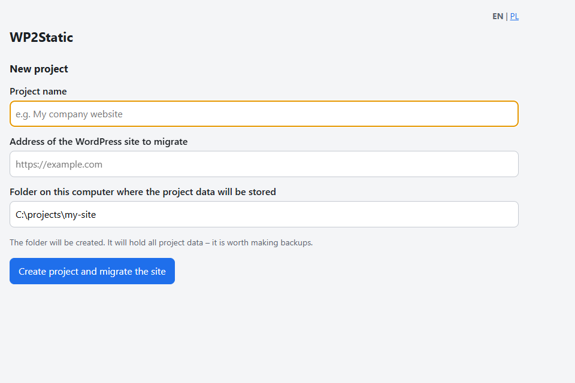
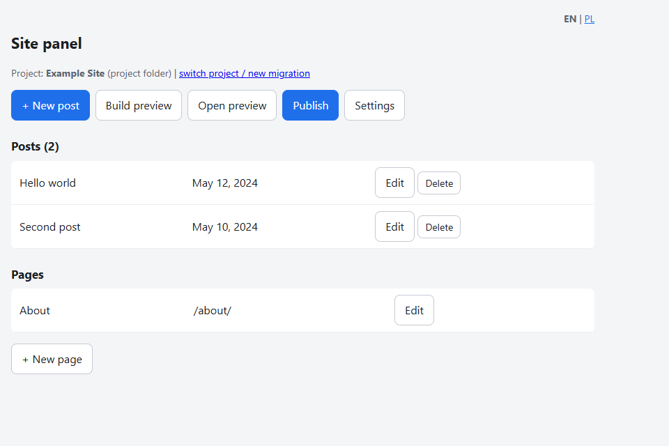

# wp2static

Migrate a WordPress site to a static website, keep updating it through a local
panel, and publish changes to ordinary shared hosting over FTP/FTPS.

Built with Go 1.22+ and the standard library only — zero third-party dependencies.

## What it does

1. **Migrate** — downloads posts, pages, media and the active theme via the
   WordPress REST API and reconstructs the site as static HTML.
2. **Edit** — a local web panel lets you add and edit posts/pages and upload
   images (no database needed).
3. **Build & preview** — generates the static site into `dist/` with a live
   preview next to the panel.
4. **Publish** — uploads only changed files to shared hosting via FTP/FTPS
   (SHA-256 change detection) and removes files for deleted posts.

## Screenshots

| Migration wizard | Panel |
|------------------|-------|
|  |  |

## Quick start (no commands)

Run the `wp2static` binary (Windows: `wp2static.exe`) — a browser opens with the
wizard: enter the address of the old site and a folder, then click
“Create project and migrate the site”. When it finishes, you land in the panel.
On the next launch the panel opens the most recent project.

An address without `http://` is treated as `https://`.

## Command line

### 1. One-time migration

    ./wp2static all https://your-site.example -out ./project

### 2. Daily work

    ./wp2static panel -out ./project      # http://127.0.0.1:8090

In the panel: Settings (FTP credentials) → New post → Build preview → Publish.

The preview runs on **panel port + 1** (`http://127.0.0.1:8091`) — the link in
the panel computes it automatically, including when ports are remapped
(Docker). If the preview ends up on another port, set it explicitly:
`WP2STATIC_PREVIEW_PORT=8095`.

Without the panel: `build`, `preview`, `publish`.

## Project structure

- `data/*.json` — posts and pages (this is the “database”; **back it up**)
- `site/` — media and theme files
- `template/` — templates extracted from the original site
- `config.json` — settings and FTP credentials (**password in plain text — do not share the folder**)
- `dist/` — generated site (do not edit)

## Publishing

Uploads only changed files (SHA-256) and removes files of deleted posts from the
host. FTPS (AUTH TLS) is enabled by default. SFTP is not supported (would need a
library outside the stdlib).

## Panel language

The panel and wizard are bilingual — English (default) and Polish. Switch with
the `EN · PL` link in the top-right corner; the choice is stored in the browser
(cookie). Log messages (import, build, publish) follow the same language.

## Limitations

Forms, search and comments are not migrated. Post content comes from the REST
API (plugin shortcodes may need manual fixes). WordPress must live in the domain
root. With the REST API disabled, a WXR file import would be required (not yet
implemented).

## Docker

    docker compose build
    docker compose up      # panel: http://127.0.0.1:8090, preview: http://127.0.0.1:8091

Data lives in `./project`. Ports are exposed on localhost only (the panel has no
login).

## Building (also on Windows)

You can build without Go on the host — Docker is enough:

    # Linux
    docker run --rm -v "${PWD}:/src" -w /src -e CGO_ENABLED=0 golang:1.22-alpine go build -o wp2static .
    # Windows (PowerShell)
    docker run --rm -v "${PWD}:/src" -w /src -e CGO_ENABLED=0 -e GOOS=windows -e GOARCH=amd64 `
      golang:1.22-alpine go build -trimpath -ldflags="-s -w" -o wp2static.exe .

Tests and formatting work the same way (`go test ./...`, `gofmt -l .`).

## License

[MIT](LICENSE)
